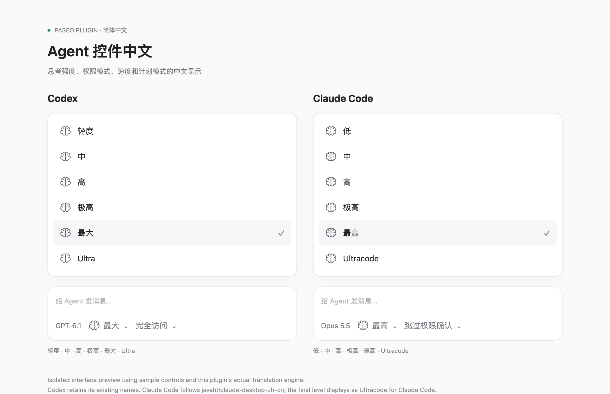

# Agent Controls Chinese

[简体中文](README.zh-CN.md)

Simplified Chinese labels for Paseo's agent composer controls: thinking effort, permission modes, speed and plan mode, with their dropdowns, tooltips and accessibility labels.



This preview uses sample controls and the actual translation engine, without user chats.

| Agent | Low | Medium | High | Extra high | Max | Ultra |
| --- | --- | --- | --- | --- | --- | --- |
| Codex | 轻度 | 中 | 高 | 极高 | 最大 | Ultra |
| Claude Code | 低 | 中 | 高 | 极高 | 最高 | Ultracode |

Claude Code's effort names follow the effort-menu mappings in [javaht/claude-desktop-zh-cn](https://github.com/javaht/claude-desktop-zh-cn/blob/25afa23cd37d32ec4f95a640213c2bb19fa4fa8d/resources/frontend-hardcoded-zh-CN.json). Its “Extra” maps to Paseo's “Extra high”. The reference does not define the final Ultra level; this plugin displays it as Ultracode for Claude Code.

## Install

Requires Paseo 0.15.4; compatibility is limited to 0.15.x. Desktop and browser clients are supported. Native iOS and Android clients are not supported.

```sh
paseo plugin add git:kogekiplay/paseo-agent-controls-zh --ref v0.1.0
```

Translation is enabled on installation. Open the Command Center and search for **Agent 控件中文：翻译设置**, or open this plugin's settings. The switch is saved per client. Disabling or unloading restores the original labels.

Menus and tooltips retain Chinese through their exit animations. Original option IDs, event handlers and permission behavior stay intact.

## Data and compatibility

This is a client-only plugin. It observes agent IDs and provider metadata through the existing Paseo connection to select a dictionary for each composer. Drafts without agent metadata recognize Claude by the displayed Claude / Opus / Sonnet / Haiku model family. Existing agents prefer their actual provider, so a Codex agent routing to another model still uses Codex labels.

It does not read chat content, contact a translation service, or change prompts, model names or permission settings. Unknown phrases keep their original text. Host control replacement uses desktop/browser page structure and may need adjustments when Paseo changes.

## Development

```sh
npm ci --ignore-scripts
npm run typecheck
npm test
paseo plugin install /absolute/path/to/paseo-agent-controls-zh
paseo plugin reload paseo-agent-controls-zh
```

- `shared/translations.ts`: general phrases and Claude-specific effort labels.
- `client/web.ts`: scoped text replacement, overlay ownership, lifecycle cleanup and browser-only APIs.
- `client/settings.tsx`: React Native settings using the host theme.
- `index.client.tsx`: registrations and provider metadata observation.

Paseo compiles the TypeScript source. There is no preparation step, backend entry or runtime dependency installation.

To regenerate the sample interface image, run `npm run preview:render` with a local Chrome/Chromium installation. Set `CHROME_BIN` when Chrome is outside the usual installation paths. The renderer uses an isolated temporary profile.

## License

MIT. Translation label reference: [javaht/claude-desktop-zh-cn](https://github.com/javaht/claude-desktop-zh-cn).
