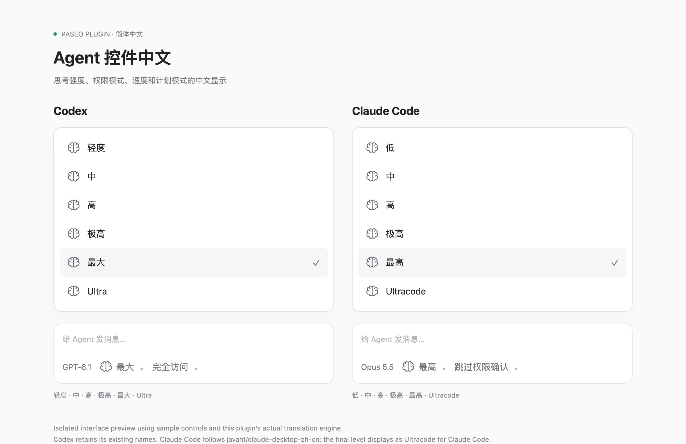

# Agent 控件中文

把 Paseo 输入框下方的思考强度、权限模式、速度、计划模式及对应菜单和提示翻译为简体中文。



演示使用示例控件和真实翻译引擎，不包含用户聊天。

| Agent | Low | Medium | High | Extra high | Max | Ultra |
| --- | --- | --- | --- | --- | --- | --- |
| Codex | 轻度 | 中 | 高 | 极高 | 最大 | Ultra |
| Claude Code | 低 | 中 | 高 | 极高 | 最高 | Ultracode |

Claude Code 的译名参考 [javaht/claude-desktop-zh-cn](https://github.com/javaht/claude-desktop-zh-cn/blob/25afa23cd37d32ec4f95a640213c2bb19fa4fa8d/resources/frontend-hardcoded-zh-CN.json) 的思考强度菜单。上游的 Extra 对应 Paseo 的 Extra high；上游没有最后一档 Ultra 的译名，本插件在 Claude Code 中将它显示为 Ultracode。

## 安装和使用

适配 Paseo 0.15.4 起的 0.15.x 和 0.16.x。提供桌面版、网页版、原生 iOS 和 Android 适配器。

```sh
paseo plugin add git:kogekiplay/paseo-agent-controls-zh --ref v0.2.8
```

安装后默认开启。通过命令中心搜索「Agent 控件中文：翻译设置」，或者在插件设置中打开翻译开关。网页端开关保存在当前浏览器；原生手机端开关在本次 App 运行期间有效，重启后默认开启。关闭、停用或卸载后恢复原文。

菜单和提示在退出动画结束前保持中文，避免关闭时短暂闪回英文。实际选项值、事件和权限行为保持不变。

## 原生手机和平板 App

在手机当前选中的 Host 上安装或更新插件。更新后请返回会话列表，再进入会话一次，让现有控件重新创建。如果手机仍缓存旧包，关闭并重新打开 App。无需重启 daemon，也无需安装定制版手机 App。

手机 App 和 Host 均需满足插件声明的版本范围。在一台 Host 安装插件，不会自动安装到其他 Host。

原生工具栏为思考强度和权限文字保留所需宽度，长模型名优先缩短，避免平板横屏时中文标签被挤成省略号。平板的紧凑工具栏会测量当前行的可用宽度，结合系统字号和当前译名估算文字预算；空间足够时恢复被隐藏的思考强度。窄分屏、手机和选择面板保留原有布局，速度和计划等功能仍由宿主决定是否收进设置。关闭翻译后恢复原有宽度和文字显示规则。

在 Paseo 0.16 中，原生折叠模型按钮使用系统的单行末尾省略，避免整词舍弃造成过早截断，让长路由模型名在相同空间内显示更多字符。模型原文、字体和外围按钮保持不变；关闭翻译后恢复宿主的整词省略。

Codex 速度选项包括 Normal、Fast 和 Ultrafast，对应翻译为「普通」「快速」和「超级快速」。悬停提示在退出动画期间也保持中文。

## 数据与适配边界

插件仅在客户端运行。网页适配器通过现有 Paseo 连接观察 Agent 标识和 Provider 元数据；尚无 Agent 快照的网页草稿根据显示的模型系列识别 Claude。原生适配器读取宿主控件已携带的 Provider。已有 Agent 优先使用真实 Provider，因此 Codex 路由到其他模型时仍使用 Codex 译名。

它不读取聊天正文、不调用外部翻译服务，也不修改提示词、模型名称或权限配置。未知文案保持原样。网页端依赖宿主页面结构；原生端接入 Paseo 0.15.4 和 0.16 向插件暴露的共享 React 元素创建函数，只处理明确识别的 Agent 控件属性、控件标识和关联菜单，同时适配 0.15 控件与 0.16 预先生成的控件项目和 Provider 选项。这不是公开的宿主国际化 API，升级 Paseo 后可能需要适配；遇到不兼容的运行时会保持原控件并在设置中提示。

## 本地开发

```sh
npm ci --ignore-scripts
npm run typecheck
npm test
paseo plugin install /absolute/path/to/paseo-agent-controls-zh
paseo plugin reload paseo-agent-controls-zh
```

`shared/translations.ts` 保存通用词典和 Claude 专用思考强度词典。`client/web.ts` 是唯一使用浏览器 API 的模块，`client/native.tsx` 适配原生渲染；`client/settings.tsx` 使用 React Native 和宿主主题。无需构建步骤或运行时依赖安装。

原生验证包括真实 React 渲染、Yoga 布局回归，以及通过 Paseo 的 Metro 模块边界加载 daemon 实际编译包的 iOS / Android 分支测试。Yoga 用固定的文本测量值检查宽度分配，不等同于设备上的字体测量或物理手机、平板验收。可设置 `PASEO_TEST_BUNDLE` 指向已编译的客户端包，再运行 `npm test -- tests/native-bundle.test.tsx`。

MIT 许可证。
